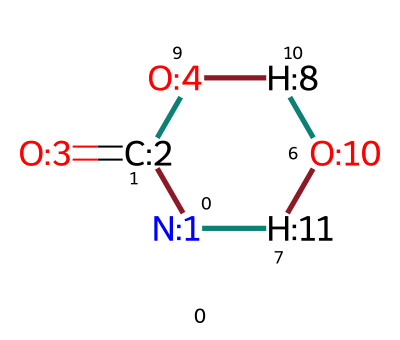
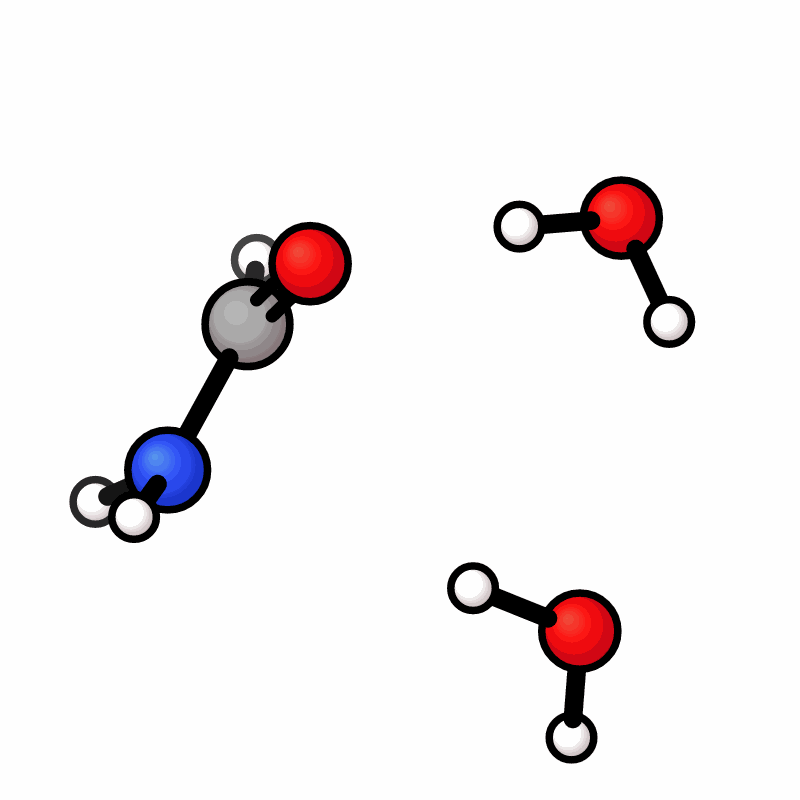

# rxts

A port of VeloxChem's reaction mapper and force-field TS guesser, using rxembed for organic and metal geometry construction.

## Install

From a checkout:

```sh
uv sync --extra ff
```

The `ff` extra installs the **in-process GFN-FF library**, which rxts calls directly from Python. Its Git source build needs a Fortran compiler and BLAS/LAPACK; see [GFN-FF's build instructions](https://github.com/pprcht/gfnff#building-from-source). MMFF works without this extra. `just setup` also installs development tools and pre-commit hooks.

rxembed and GFN-FF come from Git; `uv.lock` records their exact commits. A workflow can install `rxts[ff]`. For the notebook's figures, use `uv sync --extra ff --extra viz`.

## Quickstart

```python
import rxts

reaction = "CBr.[Cl-]>>CCl.[Br-]"
guesser = rxts.TransitionStateGuesser(engine="gfnff", multiplicity=1, n_cores=1)
rxts.set_verbose()  # show the lambda table and FF summary
path = guesser.find_transition_state(reaction)
guess = path.guess("ff")
guess.dump("guess.xyz")
path.dump("path.xyz")
```

The result is an FF path and a candidate geometry, not a verified saddle point. `find_transition_state` follows VeloxChem's naming. Inputs can be reaction SMILES, separate reactant/product SMILES, RDKit molecules, XYZ files or selected rxembed structures. Declare `multiplicity`; XYZ inputs also need an explicit `charge`.

Mapping is independently callable, without geometry construction:

```python
mapped = rxts.map_smiles(reaction)
routes = rxts.mechanisms(reaction)
```

`map_smiles` requires a choice when mapping is ambiguous. `mechanisms` returns distinct routes and their bond changes. Returned indices refer to the returned mapped reactant with explicit hydrogens.

## Settings and sampling

The guesser is a configurable object. Set options in its constructor or change the same attributes before the next call:

```python
guesser.n_conformers = 8  # initial spectator-torsion trials, including the starting geometry
guesser.n_embed = 8       # rxembed proposals per window near the peak
path = guesser.find_transition_state(reaction)
```

The attribute is `n_conformers`. Sampling is on by default:

| Setting | Default | Controls |
|---|---|---|
| `n_lambda` | 21 | FF path frames |
| `n_conformers` | 4 | Initial torsion-trial budget; also the MD trial budget when MD is enabled |
| `n_embed` | 4 | rxembed proposals per window near the peak |
| `md_steps` | 0 | Langevin steps per MD proposal; zero disables MD |

With `md_steps=0`, `n_conformers` controls the initial spectator-torsion search only. Enabling MD also requests `n_conformers - 1` new MD proposals at **every λ frame**, each lasting `md_steps` steps. `n_embed` independently controls the subsequent rxembed search near the peak; both searches can be enabled together.

For MD without the later rxembed search:

```python
md_guesser = rxts.TransitionStateGuesser(engine="mmff", multiplicity=1, n_cores=1)
md_guesser.md_steps = 50
md_guesser.n_embed = 0
md_path = md_guesser.find_transition_state(reaction)
```

The default `n_conformers=4` gives three new MD proposals per frame. Proposals are relaxed on the same frozen FFs and constraints as the scan. Counts are budgets; duplicate or rejected proposals can reduce the number retained. Set `n_conformers=1, n_embed=0` to disable sampling. By default, one selected peak conformer is carried across the path; `peak_anchored=False` selects each window independently.

Choose the interpolation engine explicitly:

| Engine | Behaviour |
|---|---|
| `"gfnff"` | Frozen GFN-FF endpoint fields |
| `"mmff"` | MMFF94 endpoint fields; errors if parameters are unavailable |
| `"auto"` | MMFF when both endpoint graphs are supported, otherwise GFN-FF; records the choice in `path.engine` |

UFF assists geometry preparation; it is not an interpolation engine. Conformational transitions with no changing bonds require GFN-FF and do not support `embed_score`.

## Optional physical scoring

Scoring evaluates geometries without moving them or replacing the FF interpolation surface. Built-in g-xTB scoring needs the separate [g-xTB executable](https://github.com/grimme-lab/g-xtb):

```python
rxts.set_xtb("/path/to/xtb")  # or leave xtb on PATH / set XTB_EXE
scores = path.score(method="gxtb", n_cores=1)
if scores.failures:
    raise RuntimeError(scores.failures)
physical_guess = path.guess("qm")
```

You can instead supply any configured ASE calculator, including an ML potential. The same object can rank peak conformers and score the finished frames:

```python
guesser.embed_score = my_calculator
path = guesser.find_transition_state(reaction)
scores = path.score(method=my_calculator)
if scores.failures:
    raise RuntimeError(scores.failures)
physical_guess = path.guess("qm")
```

`embed_score` requires `n_embed > 0` and `peak_anchored=True`. It changes which conformer generates the path. Leave it unset to select on the FF alone. A supplied calculator bypasses built-in executable checks. Reuse an instance serially; concurrent scoring needs a `CalculatorMethod` factory producing independent calculators.

`path.conformer_selections` retains the exact scored candidate geometries, their `ScoreResult`, FF energies and selected index. Scores are absolute eV; FF energies are kcal/mol. Failed attempts retain available selection evidence on the exception.

## Metals and proton relays

For metals, supply CXSMILES with explicit coordination sites or selected rxembed isomers/conformers. The [notebook](examples/quickstart.ipynb) shows compatible square-planar endpoints for a metal reaction. Plain SMILES alone does not resolve ambiguous ligand seating. Metal-angle holds come from those endpoints; `metal_angle_k=0` disables them. Hold energies are excluded from the reported FF profile.

To add a water relay:

```python
reaction = "NC=O.O>>N.O=CO"
routes = rxts.mechanisms(reaction, add_relay="O")
relay_path = guesser.find_transition_state(routes[0]["smiles"])
```

Water-assisted formamide hydrolysis, with forming bonds in green and breaking bonds in red:





Generate the drawing with `rxts.draw_mechanisms(routes[0]["smiles"]).save("changes.png")`. The [notebook](examples/quickstart.ipynb) uses xyzrender and Plotprofile directly for geometries, animations and energy profiles.

Inspect the routes before choosing one when several are returned. To use an unchanged water already present, call `rxts.mechanisms("NC=O.O.O>>N.O=CO.O", relay="O")`. `relay_map=99` selects a particular mapped protic atom. These options are mutually exclusive. Dot-separated requests such as `relay="O.O"` select a two-molecule chain; `relay_map=(99, 100)` specifies its identities and order. Ambiguous selections raise an error.

## Workflow handoff

`guess.dump("guess.xyz")` and `path.dump("path.xyz")` write XYZ files. For an in-memory ASE handoff, `guess.to_atoms()` returns one `Atoms` and `path.to_atoms()` returns an ordered list. They export the same coordinates; the ASE objects also retain atom maps and reaction metadata.

Use the exported geometries with your workflow’s refinement and verification tools.

The [notebook](examples/quickstart.ipynb) includes organic and metal reactions, direct and solvent-assisted proton transfer, MD sampling and a runnable calculator-injection example.

## Reference

The method and original implementation are credited to VeloxChem and the authors below. We adapt their work using embedding, alternate FF and calculators. We are fully responsible for any errors associated with this adaptation.

```bibtex
@article{vanHoorn2026,
  author = {van Hoorn, Bastiaan and Norman, Patrick and Ahlquist, M{\aa}rten S. G.},
  title = {From {SMILES} Codes for Reactants and Products to Transition States With {VeloxChem}},
  journal = {Journal of Computational Chemistry},
  year = {2026},
  volume = {47},
  number = {18},
  pages = {e70454},
  doi = {10.1002/jcc.70454}
}
```

BSD-3-Clause, matching VeloxChem; attribution is retained in [LICENSE](LICENSE).
