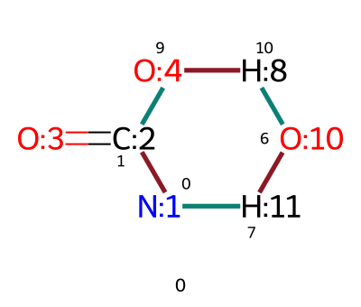
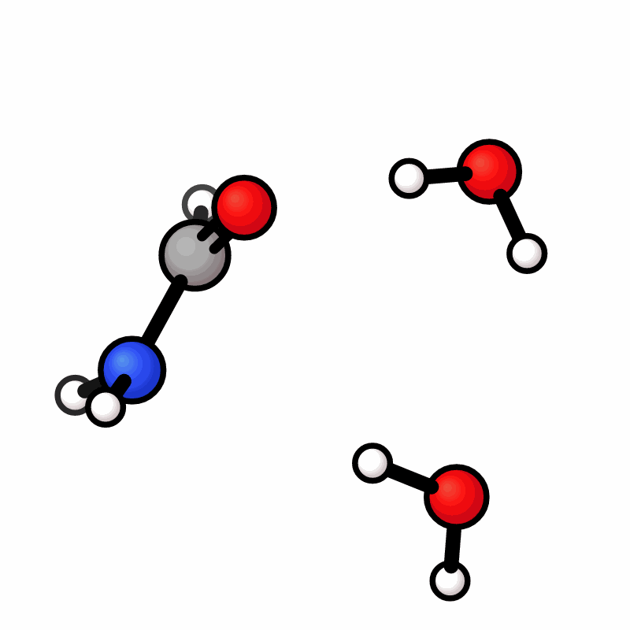

# rxts

Reaction mapping and force-field TS guesses, adapted from VeloxChem, with rxembed geometry construction for organic and metal reactions.

## Install

From a checkout:

```sh
uv sync --extra ff
```

The `ff` extra installs the **in-process GFN-FF library**, which rxts calls directly from Python. Its Git source build needs a Fortran compiler and BLAS/LAPACK; see [GFN-FF's build instructions](https://github.com/pprcht/gfnff#building-from-source). MMFF works without this extra. `just setup` also installs development tools and pre-commit hooks.

rxembed and GFN-FF come from Git; `uv.lock` records their exact commits. A workflow can install `rxts[ff]`. For the notebook's figures, use `uv sync --extra ff --extra viz`.

## Use

```python
import rxts

guesser = rxts.TransitionStateGuesser(engine="gfnff", multiplicity=1, n_cores=1)
paths = guesser.paths("CBr.[Cl-]>>CCl.[Br-]")  # one candidate path per endpoint pair
path = paths.best()  # the lowest peak
path.guess().dump("guess.xyz")
path.dump("path.xyz")
```

`guesser.find_transition_state(reaction)` returns `paths.best()` directly. From the shell, `rxts "CBr.[Cl-]>>CCl.[Br-]" --engine gfnff --multiplicity 1` writes `ts.xyz` and `ts_path.xyz`.

To score every frame with a physical calculator:

```python
scored = paths.score("gxtb")  # or "gfn2", or a configured ASE calculator
scored.best().guess()
```

Scoring returns new paths and leaves the FF ones as they were. Each scored path keeps its energies and any failures in `.scores`, and a path with failures cannot be selected. g-xTB needs the [g-xTB executable](https://github.com/grimme-lab/g-xtb) on PATH, or `rxts.set_xtb("/path/to/xtb")`.

These are candidate geometries: a numerical peak verifies neither continuity nor a saddle point. `guess.to_atoms()` and `path.to_atoms()` hand off to ASE.

## Settings

Set options on the guesser, in its constructor or before the next call:

| Setting | Default | Meaning |
|---|---|---|
| `engine` | none | `"gfnff"`, `"mmff"` (needs parameters for both endpoints) or `"auto"` (MMFF where it types, else GFN-FF) |
| `n_lambda` | 21 | Frames per path |
| `n_conformers` | 4 | Co-embedded endpoint pairs to request; one path per accepted pair |
| `n_embed` | 4 | Geometry proposals near each path's peak |

Counts are budgets: fewer pairs may be accepted. All paths share the first pair's frozen FF fields. `n_conformers=1, n_embed=0` gives a single plain scan.

## Inputs

- A reaction SMILES, or reactant and product as SMILES, RDKit Mols, XYZ files, fragment lists or selected rxembed isomers. Declare `multiplicity`; XYZ also needs `charge`.
- Endpoints are co-embedded afresh: input coordinates select the isomer but are not kept. To keep exact coordinates, pass an `rxembed.coembed(..., fixed="reactant")` batch, which is used as given.

## Metals

For metals, supply CXSMILES with explicit coordination sites or selected rxembed isomers/conformers. The [notebook](examples/quickstart.ipynb) shows compatible square-planar endpoints for a metal reaction. Plain SMILES alone does not resolve ambiguous ligand seating. Metal-angle holds come from those endpoints; `metal_angle_k=0` disables them. Hold energies are excluded from the reported FF profile.

A metal endpoint must identify one coordination isomer; `reactant_geometry` and `product_geometry` choose a shape.

## Mapping

`rxts.map_smiles(reaction)` returns the atom-mapped reaction SMILES, and `rxts.mechanisms(reaction)` lists every distinct mechanism with its bond changes. The [notebook](examples/quickstart.ipynb) covers organic and metal reactions, sampling, scoring, plotting and proton relays.

## Proton relays

To add a water relay:

```python
reaction = "NC=O.O>>N.O=CO"
routes = rxts.mechanisms(reaction, add_relay="O")
relay_path = guesser.find_transition_state(routes[0]["smiles"])
```

Water-assisted formamide hydrolysis, with forming bonds in green and breaking bonds in red:





Generate the drawing with `rxts.draw_mechanisms(routes[0]["smiles"]).save("changes.png")`. The [notebook](examples/quickstart.ipynb) uses xyzrender and Plotprofile directly for geometries, animations and energy profiles.

Inspect the routes before choosing one when several are returned. To use an unchanged water already present, call `rxts.mechanisms("NC=O.O.O>>N.O=CO.O", relay="O")`. `relay_map=99` selects a particular mapped protic atom. These options are mutually exclusive. Dot-separated requests such as `relay="O.O"` select a two-molecule chain; `relay_map=(99, 100)` specifies its identities and order. Ambiguous selections raise an error.

## Reference

The method and original implementation are credited to VeloxChem and the authors below. We adapt their work using embedding, alternate FF and calculators. We are fully responsible for any errors associated with this adaptation.

```bibtex
@article{vanHoorn2026,
  author = {van Hoorn, Bastiaan and Norman, Patrick and Ahlquist, M{\aa}rten S. G.},
  title = {From {SMILES} Codes for Reactants and Products to Transition States With {VeloxChem}},
  journal = {Journal of Computational Chemistry},
  year = {2026},
  volume = {47},
  number = {18},
  pages = {e70454},
  doi = {10.1002/jcc.70454}
}
```

BSD-3-Clause, matching VeloxChem; attribution is retained in [LICENSE](LICENSE).
